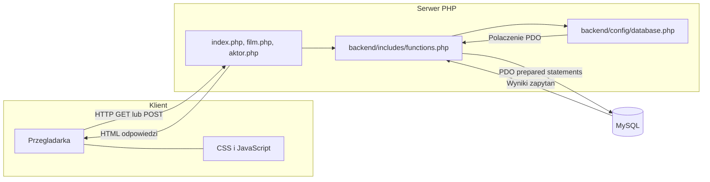
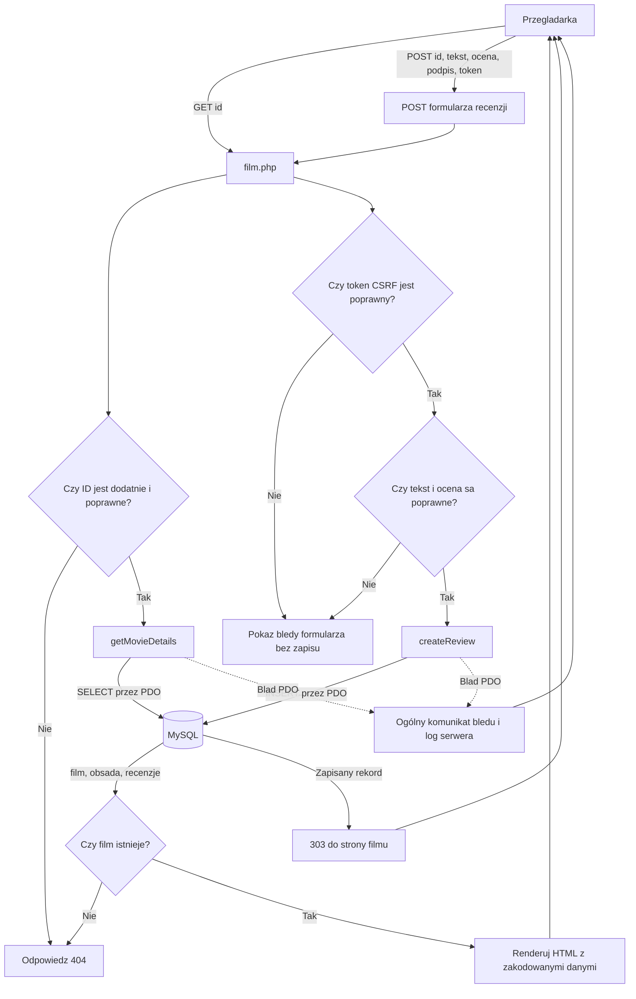

# SPECYFIKACJA ARCHITEKTONICZNA SYSTEMU

## 1. Założenia i granice

MovieDatabase jest lokalną aplikacją serwerową w PHP z bazą MySQL. Wersja podstawowa nie wymaga frameworka, routera, kont użytkowników ani panelu administracyjnego. Publiczne strony PHP pełnią równocześnie rolę kontrolera żądania i widoku HTML; wspólny moduł pomocniczy odpowiada za walidację i dostęp do danych. HTML/CSS/JavaScript pozostają lekką warstwą prezentacji.

Wymagania określają katalog filmów, wyszukiwanie po tytule, strony filmu i aktora oraz anonimowe recenzje z oceną 1–10. Teksty interfejsu i komunikaty są po angielsku. Pliki aplikacji i schemat bazy były puste w chwili opracowania dokumentu, dlatego jest to projekt docelowy, a nie opis istniejącej implementacji.

| Sourced - potwierdzone w źródłach | Inferred - decyzja lub hipoteza do realizacji/potwierdzenia |
| :--- | :--- |
| `requirements.md` wymaga PHP/MySQL, katalogu i wyszukiwania filmów, szczegółów filmu i aktora, relacji obsady N:M oraz anonimowych recenzji ocenianych od 1 do 10. Interfejs ma być po angielsku; konta i panel administracyjny są poza zakresem. | Proste skrypty stron będą obsługiwać żądania i renderować HTML, a `functions.php` zapewni współdzielone operacje i walidację. To proponowany podział, ponieważ pliki implementacji są puste. |
| Dostarczone szkielety PHP i `database/schema.sql` nie zawierają implementacji; `database.md` jest pusty. | Treść recenzji będzie wymagana, podpis opcjonalny; POST będzie zabezpieczony tokenem CSRF i zakończy się przekierowaniem PRG. Wymaga to potwierdzenia w specyfikacji wymagań/bazy przed implementacją. |
| Minimalne wersje PHP oraz limity długości tekstów nie są określone w wymaganiach. | Konfiguracja PDO przez zmienne środowiskowe oraz konkretne typy i długości kolumn pozostają propozycją do doprecyzowania po ustaleniu środowiska i schematu. Opcje cookie `SameSite` w sesji wymagają PHP 7.3+; należy używać wspieranej wersji PHP. |

## 2. Struktura katalogów i odpowiedzialność

```text
MovieDatabase/
├── backend/
│   ├── config/
│   │   └── database.php       # Konfiguracja i fabryka połączenia PDO z MySQL
│   └── includes/
│       └── functions.php      # Walidacja, zapytania i wspólne funkcje aplikacji
├── database/
│   ├── schema.sql             # Tabele, klucze i ograniczenia bazy
│   ├── seed.sql               # Opcjonalne dane demonstracyjne
│   └── queries.sql            # Pomocnicze zapytania SQL dla projektu
├── Docs/
│   ├── Specs/                 # Wymagania, architektura i specyfikacja bazy
│   ├── Sessions/              # Podsumowania pracy ról projektowych
│   └── Reports/               # Raport końcowy, testów i bezpieczeństwa
├── frontend/
│   ├── css/style.css          # Responsywny układ i style
│   └── js/script.js           # Niewymagana do bezpieczeństwa walidacja UI
├── index.php                  # Katalog filmów i wyszukiwanie
├── film.php                   # Szczegóły filmu, obsada, recenzje i formularz
├── aktor.php                  # Profil aktora i lista filmów
└── README.md                  # Konfiguracja i uruchamianie lokalne
```

| Moduł | Odpowiedzialność |
| :--- | :--- |
| `index.php` | Odczytuje parametr wyszukiwania, pobiera katalog i renderuje listę lub stan pusty. |
| `film.php` | Pobiera film, obsadę i recenzje; obsługuje POST formularza recenzji oraz odpowiedzi błędów. |
| `aktor.php` | Pobiera profil aktora i przypisane filmy; obsługuje brak lub niepoprawne ID. |
| `backend/config/database.php` | Tworzy połączenie PDO z ustawień środowiskowych `DB_HOST`, `DB_PORT` (opcjonalne, domyślnie `3306`), `DB_NAME`, `DB_USER` i `DB_PASSWORD`; nie zawiera sekretów w repozytorium. |
| `backend/includes/functions.php` | Udostępnia walidację i funkcje pobierania/zapisu; nie generuje HTML i nie wypisuje odpowiedzi HTTP. |
| `database/` | Źródło definicji schematu oraz opcjonalnych danych startowych. Szczegóły tabel i kolumn określa `database.md`. |
| `frontend/` | Zasoby statyczne. JavaScript może poprawiać wygodę, ale nie zastępuje walidacji serwerowej. |

## 3. Warstwy i przepływ odpowiedzialności

1. **Przeglądarka** wysyła żądanie HTTP i renderuje HTML, CSS oraz opcjonalny JavaScript.
2. **Skrypt strony** (`index.php`, `film.php` lub `aktor.php`) sprawdza metodę i parametry, wywołuje funkcje aplikacyjne i wybiera odpowiedź HTML albo przekierowanie.
3. **Moduł funkcji** waliduje wartości ponownie po stronie serwera i wykonuje operacje domenowe. Każde zapytanie dynamiczne jest przygotowane przez PDO i wiąże wartości jako parametry.
4. **Konfiguracja bazy** udostępnia połączenie PDO z MySQL. Połączenie jest tworzone na żądanie i nie jest serializowane ani przekazywane klientowi.
5. **MySQL** przechowuje filmy, aktorów, relację N:M obsady i recenzje. Klucze obce utrzymują spójność powiązań; szczegółowy model należy do `database.md` i `schema.sql`.

### Diagram architektury klient–serwer–baza



## 4. Kontrakty komunikacyjne

### Przeglądarka → strony PHP

| Strona | Kontrakt żądania | Odpowiedź |
| :--- | :--- | :--- |
| `index.php` | `GET`; opcjonalne `q` jako tekst wyszukiwania po tytule. Pusty lub pominięty `q` oznacza pełny katalog. | `200` z listą albo czytelnym stanem braku wyników. |
| `film.php` | `GET` z dodatnim całkowitym `id`; formularz recenzji wysyła `POST` z `id`, `review_text`, `rating`, opcjonalnym `display_name` i tokenem CSRF. | `200` z filmem, obsadą, recenzjami i formularzem; `404` dla nieistniejącego filmu; po poprawnym zapisie `303` do strony filmu (PRG). |
| `aktor.php` | `GET` z dodatnim całkowitym `id`. | `200` z profilem i filmami aktora albo `404`, gdy aktor nie istnieje. |

Wartości żądania są traktowane jako niezaufane. Parametry identyfikujące rekord muszą być dodatnimi liczbami całkowitymi. Dla niepoprawnych parametrów strona wyświetla bezpieczny komunikat, nie wykonuje zapytania i nie ujawnia szczegółów technicznych.

### Strony PHP → moduł funkcji

Poniższe sygnatury opisują kontrakt logiczny; dokładne nazwy kolumn i kształt rekordów muszą być zgodne z zatwierdzonym `database.md`.

| Funkcja | Wejście | Wynik / zachowanie |
| :--- | :--- | :--- |
| `getPDO(): PDO` | Konfiguracja środowiska serwera. | Połączenie PDO z MySQL skonfigurowane dla UTF-8 i wyjątków. Błąd połączenia jest wyjątkiem, nie komunikatem dla użytkownika. |
| `executeQuery(PDO $pdo, string $sql, array $parameters = []): PDOStatement` | Połączenie, SQL i tablica parametrów. | Przygotowuje i wykonuje zapytanie; błąd PDO jest logowany po stronie serwera i opakowywany jako `RuntimeException`. |
| `escapeHtml($value): string` | Wartość skalarna albo `null`. | Koduje wartość przez `htmlspecialchars(..., ENT_QUOTES | ENT_SUBSTITUTE, 'UTF-8')`; wartości nieskalarne są odrzucane. |
| `getMovies(string $query = ''): array` | Tekst wyszukiwania; pusty oznacza katalog bez filtra. | Lista filmów; wyszukiwanie tytułu nie rozróżnia wielkości liter. |
| `getMovieDetails(int $movieId): ?array` | Dodatnie ID filmu. | `null`, jeśli rekord nie istnieje; w innym przypadku pola filmu oraz klucze `cast` i `reviews` zawierające listy rekordów. |
| `getActorDetails(int $actorId): ?array` | Dodatnie ID aktora. | `null`, jeśli rekord nie istnieje; w innym przypadku pola aktora oraz klucz `films` z filmografią. |
| `createReview(int $movieId, string $reviewText, int $rating, ?string $displayName): void` | Istniejące ID filmu, niepusty tekst recenzji, całkowita ocena 1–10 oraz opcjonalny podpis. | Zapis pojedynczej recenzji. Naruszenie reguł wejścia jest błędem walidacji; błąd PDO jest wyjątkiem i nie może ujawnić się w HTML. |
| `parsePositiveId($value, string $label): int` | Surowa wartość z parametru żądania. | Zwraca dodatnie całkowite ID; odrzuca niecyfrowe, zerowe i przepełnione wartości przez `InvalidArgumentException`. |
| `parseRating($value): int` | Surowa wartość z formularza. | Zwraca ocenę całkowitą 1–10; pozostałe wartości odrzuca przez `InvalidArgumentException`. Wywołać przed `createReview()`, bez rzutowania wejścia przez `(int)`. |
| `getCsrfToken(): string` | Bieżąca sesja aplikacji. | Rozpoczyna sesję, jeśli trzeba, i zwraca token CSRF o stałej długości do formularza. |
| `isValidCsrfToken(string $submittedToken): bool` | Token z POST i aktywna sesja. | Porównuje token przez `hash_equals()`; zwraca `false`, gdy sesja lub token są niepoprawne. |
| `startAppSession(): void` | Brak. | Rozpoczyna sesję z cookie `HttpOnly`, `SameSite=Lax` i `Secure` przy HTTPS; wywołać przed wysłaniem jakiegokolwiek HTML. |

Funkcje pobierające i zapisujące używają wyłącznie `PDO::prepare()` oraz `PDOStatement::execute()` dla zapytań dynamicznych. Warstwa strony przekazuje parametry jako wartości, nigdy jako fragmenty SQL. Wyjątki infrastrukturalne są rejestrowane po stronie serwera, a klient otrzymuje ogólny komunikat.

### Moduł PHP → MySQL

- Relacja filmu z aktorami jest N:M i jest realizowana przez tabelę łącznikową z kluczami obcymi.
- Recenzja należy do jednego filmu; `rating` jest całkowitą liczbą z zakresu 1–10. Podpis może być pusty/`NULL` zgodnie z uzgodnionym schematem.
- Zapisy recenzji wskazują istniejący film. Ograniczenia bazy uzupełniają walidację aplikacji, ale jej nie zastępują.
- Nazwy tabel, kolumn, indeksy, długości pól i reguły usuwania są definiowane w `Docs/Specs/database.md`; architektura nie wprowadza równoległego schematu.

## 5. Bezpieczeństwo i obsługa błędów

- Dane połączenia pochodzą ze zmiennych środowiskowych `DB_HOST`, `DB_NAME`, `DB_USER`, `DB_PASSWORD` oraz opcjonalnie `DB_PORT`; brak wymaganych ustawień kończy inicjalizację kontrolowanym błędem serwera. Żadnych haseł ani sekretów nie umieszcza się w kodzie ani repozytorium.
- PDO używa wyjątków, kodowania `utf8mb4` i natywnych prepared statements, gdzie wspiera je środowisko. Każda wartość od użytkownika jest walidowana po stronie PHP i przekazywana jako parametr.
- Wszystkie wartości dynamiczne w HTML są kodowane przez `htmlspecialchars($value, ENT_QUOTES, 'UTF-8')`.
- Formularz recenzji jest wysyłany metodą POST. Token CSRF przechowywany w sesji ogranicza możliwość wysłania formularza z obcej strony; po poprawnym zapisie stosowany jest wzorzec Post/Redirect/Get.
- Ocena jest walidowana jako liczba całkowita od 1 do 10; tekst recenzji po normalizacji nie może być pusty; długości pól muszą odpowiadać schematowi bazy.
- Błędy wejścia są prezentowane przy formularzu po angielsku. Błędy PDO są logowane po stronie serwera, nie wyświetlają SQL, konfiguracji, ścieżek ani stosu wywołań.
- Dla braku rekordu strona zwraca `404`; błąd infrastruktury kończy się kontrolowaną odpowiedzią `500`. Nie pokazuje się częściowych danych ani komunikatu wyjątku.

## 6. Diagram przepływu danych



## 7. Decyzje i kwestie do potwierdzenia

- Strony PHP pozostają jawnie nazwanymi punktami wejścia; nie dodaje się frameworka, warstwy API ani nowych kontrolerów bez zmiany zatwierdzonego zakresu.
- Wymagania określają anonimowe recenzje i opcjonalny podpis. W tym projekcie tekst recenzji jest traktowany jako wymagany; tę interpretację należy potwierdzić przy aktualizacji wymagań i specyfikacji bazy.
- Moderacja i ograniczanie nadużyć w anonimowych recenzjach są poza zakresem wersji podstawowej.
- Minimalne wersje PHP i MySQL należy ustalić po sprawdzeniu środowiska docelowego, przed implementacją.
- Funkcje, nazwy tabel i struktury rekordów są kontraktem do realizacji; nie są potwierdzone działającym kodem.
