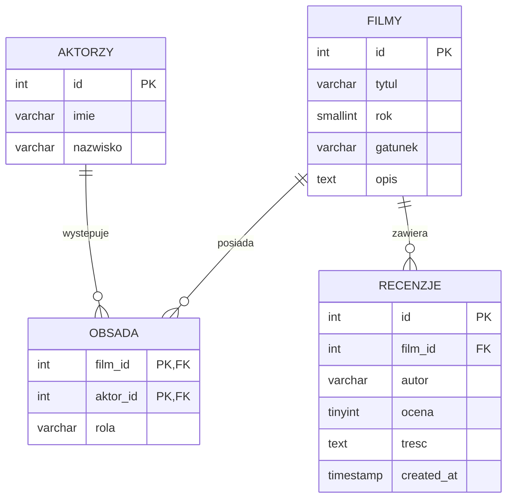

# DOKUMENTACJA BAZY DANYCH

## 1. Źródła i decyzje

| Sourced - potwierdzone w wymaganiach/architekturze | Inferred - decyzja projektowa lub założenie |
| :--- | :--- |
| Wymagane są tabele `filmy`, `aktorzy`, `obsada` i `recenzje`; obsada jest relacją N:M z kluczem złożonym `(film_id, aktor_id)`. Recenzja wskazuje film i ma całkowitą ocenę 1–10. | ID są `INT UNSIGNED AUTO_INCREMENT`; tabele używają InnoDB i `utf8mb4`. Skrypt zakłada MySQL 8.0.16 lub nowszy, aby ograniczenie `CHECK` dla oceny było egzekwowane. |
| Film ma tytuł, rok, gatunek i opis; aktor ma imię i nazwisko; obsada ma rolę; recenzja ma autora, ocenę i treść. Podpis autora jest opcjonalny. | Treść recenzji jest wymagana (`NOT NULL`), a rola w obsadzie może być nieznana (`NULL`). Recenzja ma znacznik czasu utworzenia. Te reguły uzupełniają niedookreślony model i powinny być uwzględnione przez backend. |
| Dane wejściowe mają być walidowane serwerowo, zapytania wykonywane PDO prepared statements, a powiązania zachowane kluczami obcymi. | Usunięcie filmu usuwa jego obsadę i recenzje; usunięcie aktora usuwa jego wpisy obsady. Wartości są indeksowane pod listowanie, wyszukiwanie i odwrotne wyszukiwanie obsady. |

## 2. Diagram ERD



## 3. Tabele i ograniczenia

### `filmy`

| Kolumna | Typ SQL | Null | Znaczenie |
| :--- | :--- | :--- | :--- |
| `id` | `INT UNSIGNED AUTO_INCREMENT` | Nie | Klucz główny filmu. |
| `tytul` | `VARCHAR(255)` | Nie | Tytuł wyświetlany i przeszukiwany bez rozróżniania wielkości liter. |
| `rok` | `SMALLINT UNSIGNED` | Nie | Rok wydania. |
| `gatunek` | `VARCHAR(100)` | Nie | Pojedyncza wartość gatunku w wersji podstawowej. |
| `opis` | `TEXT` | Tak | Opis filmu; może być nieznany. |

Indeksy: klucz główny `id`, indeks `tytul` oraz indeks `(gatunek, rok)`. Nie wprowadzono unikalności tytułu, ponieważ remaki i filmy o takim samym tytule są możliwe.

### `aktorzy`

| Kolumna | Typ SQL | Null | Znaczenie |
| :--- | :--- | :--- | :--- |
| `id` | `INT UNSIGNED AUTO_INCREMENT` | Nie | Klucz główny aktora. |
| `imie` | `VARCHAR(100)` | Nie | Imię aktora. |
| `nazwisko` | `VARCHAR(100)` | Nie | Nazwisko aktora. |

Indeks `(nazwisko, imie)` wspiera sortowanie i wyszukiwanie osób. Celowo brak ograniczenia unikalności imienia i nazwiska, bo nie jest to pewny identyfikator osoby.

### `obsada`

| Kolumna | Typ SQL | Null | Znaczenie |
| :--- | :--- | :--- | :--- |
| `film_id` | `INT UNSIGNED` | Nie | Klucz obcy do `filmy.id`. |
| `aktor_id` | `INT UNSIGNED` | Nie | Klucz obcy do `aktorzy.id`. |
| `rola` | `VARCHAR(150)` | Tak | Nazwa postaci/roli, jeśli jest znana. |

Klucz główny `(film_id, aktor_id)` zapobiega powtórzeniu tego samego aktora w obsadzie filmu. Dodatkowy indeks `(aktor_id, film_id)` obsługuje stronę aktora i jego filmografię.

### `recenzje`

| Kolumna | Typ SQL | Null | Znaczenie |
| :--- | :--- | :--- | :--- |
| `id` | `INT UNSIGNED AUTO_INCREMENT` | Nie | Klucz główny recenzji. |
| `film_id` | `INT UNSIGNED` | Nie | Klucz obcy do filmu, którego dotyczy recenzja. |
| `autor` | `VARCHAR(100)` | Tak | Opcjonalny podpis; `NULL` oznacza recenzję anonimową. |
| `ocena` | `TINYINT UNSIGNED` | Nie | Ocena ograniczona do całkowitych wartości od 1 do 10. |
| `tresc` | `TEXT` | Nie | Treść recenzji. Wymagalność jest założeniem zgodnym z kontraktem architektury. |
| `created_at` | `TIMESTAMP` | Nie | Czas utworzenia ustawiany przez MySQL. |

Klucz obcy `film_id` wskazuje `filmy.id`; indeks `(film_id, created_at)` przyspiesza pobieranie recenzji filmu. Ograniczenie `CHECK (ocena BETWEEN 1 AND 10)` uzupełnia walidację po stronie PHP. Wymagane jest MySQL 8.0.16+; aplikacja nadal musi odrzucać ocenę spoza zakresu, także gdyby baza nie egzekwowała ograniczeń.

## 4. Integralność referencyjna i usuwanie

- `obsada.film_id` → `filmy.id`: `ON UPDATE CASCADE`, `ON DELETE CASCADE`.
- `obsada.aktor_id` → `aktorzy.id`: `ON UPDATE CASCADE`, `ON DELETE CASCADE`.
- `recenzje.film_id` → `filmy.id`: `ON UPDATE CASCADE`, `ON DELETE CASCADE`.
- Oba pola klucza złożonego obsady są `NOT NULL`; wiersz nie może istnieć bez istniejącego filmu i aktora.
- Usunięcie filmu usuwa powiązaną obsadę i recenzje. Usunięcie aktora usuwa wyłącznie powiązania obsady.

## 5. Skrypty i uruchamianie

- `database/schema.sql` tworzy bazę `moviedatabase` i cztery tabele InnoDB. Nie usuwa istniejącej bazy ani tabel.
- `database/seed.sql` dodaje fikcyjne filmy, aktorów, obsadę i recenzje. Można uruchamiać ponownie: rekordy przykładowe są rozpoznawane po tytule/roku, nazwisku lub istniejącym powiązaniu/recenzji.
- `database/queries.sql` zawiera przykłady zapytań katalogowych, szczegółów, obsady, filmografii i zapisu recenzji. Parametry `:name` są placeholderami PDO; zapytania należy wykonywać przez `PDO::prepare()` i `PDOStatement::execute()`, nigdy przez konkatenację danych wejściowych.

Przykładowa kolejność importu w lokalnym MySQL:

```sh
mysql -u <user> -p < database/schema.sql
mysql -u <user> -p moviedatabase < database/seed.sql
```

Hasło jest pobierane interaktywnie przez klienta MySQL i nie należy umieszczać go w repozytorium ani poleceniu zapisanym w dokumentacji.

## 6. Wyszukiwanie i zapytania

Kolacja `utf8mb4_0900_ai_ci` zapewnia porównania tekstu bez rozróżniania wielkości liter i akcentów. Zapytanie wyszukiwania używa `LIKE` z parametrem. Aplikacja powinna przed dodaniem `%` z obu stron uciec w tekście wyszukiwania znaki `!`, `%` i `_`, zgodnie z `ESCAPE '!'` w `queries.sql`; przygotowanie zapytania chroni przed SQL injection, a escapowanie zachowuje oczekiwaną semantykę wyszukiwania.

Indeks B-tree na `tytul` pomaga sortować i filtrować, ale wyszukiwanie wzorca z początkowym `%` może wymagać skanowania tabeli. Dla małego katalogu jest to akceptowalne; optymalizacja wyszukiwania pełnotekstowego wymaga osobnego uzgodnienia.

## 7. Ograniczenia i kwestie otwarte

- Zakres pojedynczego gatunku jest decyzją wersji podstawowej; wiele gatunków na film wymagałoby tabeli słownikowej i nowej relacji.
- Brak tabel użytkowników jest zgodny z anonimowym dodawaniem recenzji; moderacja i ochrona przed nadużyciami nie są częścią zatwierdzonego zakresu.
- Limity długości tytułu, podpisu i roli są decyzjami projektowymi i muszą odpowiadać walidacji PHP oraz formularzom.
- Przy migracji na MySQL starszy niż 8.0.16 należy zapewnić obsługę ograniczenia oceny inną drogą lub podnieść wersję serwera; sam komentarz/test aplikacyjny nie zastępuje walidacji PHP.
